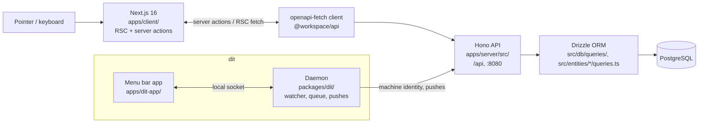

# Projammr — Agent Guidelines

Projammr is a music project management app for tracking tracks, sessions, and collections across music projects. It's a
Bun + Turborepo monorepo with three apps — a Next.js web client, a Hono REST API, and dit's Tauri menu bar app (the
DAW reader) — plus shared UI and API packages.

This document exists to keep Projammr **minimal, elegant, and proper**. The best code is the code never written; nearly
all the principles below are in support of this core principle. Per-app detail is in each app's own `CLAUDE.md` and in
`docs/agents/`; how to send a change is in `CONTRIBUTING.md`.

## Architecture

The server (`apps/server/`) is the single source of truth: Hono on port 8080, mounted at `/api`, with PostgreSQL behind
Drizzle ORM. The API is **OpenAPI-first** — every route is defined with `hono-openapi`, the spec is served at
`/api/openapi`, and client types are generated from it (`bun run typegen` from the root writes `packages/api/src/v1.d.ts`
and `packages/api/src/enums.ts`; `enums.ts` is committed, `v1.d.ts` is gitignored). Auth is Better Auth (email/password, cookie sessions, a `bearer()`
plugin for dit) served through the same Hono app; a global middleware resolves the session on every request,
protected routes use `authenticated`, and project-scoped routes use `authorizeProject` for role checks.

The client (`apps/client/`) is Next.js 16 (App Router, RSC-first, React 19). Data reaches the UI two ways: server
components / server actions (`src/actions/`, typed via `openapi-fetch` from `@workspace/api`), and client components
that call the same API client directly. Routes under `/project/*` are guarded by `src/proxy.ts` (Next 16's rename of
middleware) and parsed by hand — `src/lib/route-parser.ts` maps URL segments to a discriminated union of module kinds;
there is no file-based routing below `/project/[projectId]`.

dit (`apps/dit-app/` and the `packages/dit` Rust workspace) reads DAW sets: a Tauri 2 menu bar app over a Rust daemon
that records saves as revisions and pushes them to the server under a machine identity (`docs/agents/dit.md`).

The site (`apps/web/`) is the public marketing site and docs: Astro with Starlight at `/docs`, built fully static.
React components from `@workspace/ui` render to HTML with no hydration. It reads the server only at build time,
through the committed OpenAPI specs and the files its generated references parse, so it needs no running server.

**Runtime stack** — request to row:



**Repo layout:**

```
apps/
  client/                   Next.js 16 frontend (`next dev`, plain Node)
    src/app/                Route tree; [...route] custom sub-router
    src/modules/            Per-entity server components (project, collection,
                            track, session, settings)
    src/components/         Client components, grouped by feature
    src/actions/            Server actions — typed openapi-fetch calls
    src/lib/, src/hooks/    Pure helpers (with co-located *.test.ts) and hooks
    src/proxy.ts            Session gate for /project/* (Next 16 "middleware")
  server/                   Hono REST API (:8080, /api)
    src/app.ts              The Hono app (no listen); src/server.ts binds :8080
    src/entities/           One directory per entity (project, collection, track,
                            session, track-audio): schema refs, queries, routes,
                            registered through src/entities/index.ts
    src/routes/             Non-entity routers (auth, me, images, assets, comments,
                            statuses, jobs, notes, lyrics, sharelinks, invites, …)
    src/middleware/         session, authenticated, authorizeProject, rate-limit,
                            trusted-origin, request-log
    src/lib/                Storage, media (ffmpeg), jobs, crypto, env, …
    src/db/
      schema/               All tables + enums + zod schemas, one file per area
      queries/              Cross-entity query layer
      migrations/           Drizzle migrations
    src/test/               Test fixtures (setupSuite, media helpers)
  dit-app/                  dit's menu bar app (Tauri 2): the panel's React UI in src/, its own Cargo workspace in
                            src-tauri/ (docs/agents/dit.md "The app")
  web/                      Astro + Starlight marketing site and docs (static, Cloudflare Pages)
    src/pages/              Marketing pages; src/content/docs/docs/<section>/ holds the docs
    openapi/                The committed API specs the reference is generated from
    scripts/screenshots/    Screenshot manifest and capture script (demo catalogue)
packages/
  ui/                       @workspace/ui — shadcn/ui library, consumed as source TSX;
                            globals.css is the design-token layer
  api/                      @workspace/api — API types, openapi-fetch client,
                            Better Auth client (v1.d.ts and enums.ts are generated; only enums.ts is committed)
  dsp/                      @workspace/dsp — the spectrum maths the server's analysis job
                            and the client's AudioWorklet both run
  session-diff/             @workspace/session-diff — the save-to-save diff model (chips, readouts,
                            structure, samples), pure TypeScript the server and the client share
  settings/                 @workspace/settings — the settings registry: every setting
                            declared once (zod schema, default, metadata) and the resolver
                            server, client and dit share; one file per group
  test/                     @workspace/test — bun:test stubs (stubGlobal, stubEnv, fake-timer and
                            polling helpers) shared by every test suite
  demo/                     @workspace/demo — the demo catalogue: seed through the API,
                            snapshot and restore it, for the site's screenshots
  eslint-config/            Shared ESLint flat configs (base, next, react-internal, design-tokens)
  typescript-config/        Shared tsconfig presets (base, nextjs, react-library, library)
  dit/                      Rust workspace (not a bun package): dit-core (objects, repo, diff, remote), dit-daws and
                            dit-daw-ableton (DAW modules), dit-cli (the `dit` binary and its lib), dit-ipc (the local
                            socket), dit-daemon (watcher, queue, beat, renders), dit-wasm (docs/agents/dit.md)
```

### Read this first

- **Any Next.js code:** read the docs in `node_modules/next/dist/docs/` first. This is Next.js 16 — `proxy.ts`
  instead of `middleware.ts`, `params` is a Promise, Turbopack by default. Do not rely on memory of Next 13–15.
- **Client routing or any `/project/*` URL:** read `apps/client/src/lib/route-parser.ts`. New URL shapes mean
  extending `parseRoute` and `src/modules/`, not adding file-based routes.
- **Any area:** read the matching reference in `docs/agents/` (`server-api.md`, `db.md`, `client.md`, `packages.md`,
  `dit.md`, `web.md`, `monorepo.md`). They record the route table, every table and column, the component map, and the
  gotchas already found. Update the one for the area you change in the same pull request.
- **Any UI (client, dit app, share page):** read `DESIGN.md` and `PRODUCT.md`.

## DRY Principle

Don't Repeat Yourself — and interpret this broadly. If two pieces of code aren't identical but follow a similar enough
pattern that they could be generalized, they should be. This applies across modules and across the whole monorepo
(client, server, dit, shared packages).

**Search before writing.** Before writing anything, check whether it already exists or has siblings: search the tree
for the symbol or behaviour, and for what a change to a named symbol touches across files, tests and docs. You may find
overlap that can be extracted into a shared component (into `@workspace/ui` or `@workspace/api` when it belongs in a
package) — or, better, that what you need is already written and can simply be imported.

**Place functionality where it generalizes.** Before writing logic, ask: "where does this belong so that it works for
all cases, not just this one?" If a behavior applies to any entity (project, collection, track, session), it belongs in
the shared form/table/patch machinery — not special-cased in one module. If a behavior applies to any API call, it
belongs in `@workspace/api` — not re-implemented per app. A good signal you've placed something wrong: it only works
for one workflow, or a second caller would have to copy-paste the same pattern.

**Stop-sign phrases.** If you find yourself writing "mirrors X", "bit-exact copy of X", "keep in sync with X", or
"identical to X" in a comment, you are duplicating code. Pause and consider why you're doing it. If it's not easily
factorable into a shared feature, stop and raise the issue with the maintainers.

## Modularity Principle

**Default to modular.** When you design anything with more than one variant — or that will plausibly grow one — the
first question is "what's the unit, and how does the rest of the code stay ignorant of which one it's looking at?" That
mindset applies at every scale: from a small enum where one method per variant beats a switch at the call site, up to
full subsystems with interfaces, registries, and per-variant files. Hand-written dispatch should feel like an exception
that needs justifying, not the default shape. The server's `src/entities/` registry is the model: a new entity is one
directory plus a registration, not a case added to every consumer.

Module-specific code lives in the module. Module-generic infrastructure — registries, dispatchers, shared state,
caches — is generic by name and by shape, never named after any single module that happens to use it today.

When adding a new item to a modular system (a new entity type, a new table column family, a new form field type, a new
route kind, etc.):

- **DO:** Create a single file (or module directory) in the appropriate place that contains everything about that
  module — types, implementation, registration, constants, helpers.
- **DO NOT:** Add a case to a central switch. Add an entry to a handwritten list. Touch any file outside the module
  except the index that re-exports it.

**Type-owned dispatch:** Anything a type knows about itself — behavior, properties, capabilities, identity — lives on
the type, behind a uniform interface. Consumers call methods; they never introspect, classify, or branch on which
variant they got. The diagnostic question: _would adding a new variant, or changing what an existing one knows about
itself, force me to edit this code?_ If yes, the knowledge is misplaced. The violation has one recurring shape —
`switch (kind)`, `if (type === "x")`, `isFoo()` helpers, or any consumer-side mapping table that routes by type.
Replace it with a method on the type, defaulted to the common case and overridden per variant.

## Ownership Principle

State belongs to the thing it describes — not to a parent that manages it on its behalf. Don't let the type system or
the framework dictate the data model. If splitting state out of an object makes a type check or a React render pass
easier but scatters a logical concept across multiple locations, find a different way (derived values, co-located state,
restructured access) and keep the data model clean.

## Server Authority Principle

The **database** (modelled in `apps/server/src/db/schema/`) is the authoritative model. State falls into three
categories:

- **Server** (Postgres): persistent, the source of truth. Entities, relations, statuses, comments, attachments. Must
  be possible to reason about without a browser.
- **Session** (auth session, `currentProject` cookie, form state, view state): transient. Does not survive reload,
  except where explicitly persisted.
- **Client** (React component state, table state, editor buffers): derived realization. Always rebuildable from the API
  on the next fetch.

**Data flows downhill: server → client.** Mutations flow up only through API routes (server actions or the API
client). The client never keeps an authoritative copy of server state. If a piece of state seems to want to live in two
places, the model is broken — fix the originating operation to lead with the server.

**Anti-patterns to refuse:** a client-side cache of an entity that must be manually re-synced after every mutation
instead of refetched or derived; the same fact stored in a prop, a hook, and a cookie "for ergonomics"; a server field
and a client-side duplicate that drift (e.g. a status percentage computed in the client instead of by the server).

**When in doubt:** if the value survives a reload and a restart, it's server state. If it can be rebuilt from the API,
it's client state. Otherwise it's session state.

## Credit Principle

When an idea, algorithm, component, or implementation comes from an external source — open source code, shadcn/ui
registries, papers, blog posts, video tutorials, etc. — credit the source and author at the top of the file (or inline
next to the borrowed fragment, if it's smaller than file-scope). Include the author's name or handle and a link to the
original.

## Testing Principle

**Every feature must have a test.** Verify the feature works. The test exists; it passes. That's it.

**Every bug must have a _regression_ test — one that defends against that specific bug being reintroduced.** Write it
FIRST, confirm it FAILS against the unfixed code, then fix the bug and confirm it passes; if it doesn't fail without the
fix, it doesn't count.

**A test asserts that something works, never how fast.** No assertion on elapsed time (`performance.now()`,
`Date.now()` deltas): on a machine running several agents it fails for reasons that are not the code. A hang is
caught by the test's timeout, which every suite sets to 30 seconds (`--timeout=30000` in each `test` script), so
a test that needs longer is rare and says why beside its own timeout. Wait on the thing itself (a promise, an
event, `waitFor`), not on a sleep sized to a fast machine.

Where tests live and how they run is in each app's `CLAUDE.md`. In short: `bun test` everywhere (imports from `bun:test`,
shared stubs such as `stubGlobal`, `stubEnv`, `advanceTimersByTimeAsync` and `waitFor` in `@workspace/test`); the
server suite needs a live Postgres and runs on its own (`cd apps/server && bun run test`); every other suite runs from
the root (`bun run test`, turbo). Importing the server app no longer binds a port — `src/app.ts` builds the app, `src/server.ts` listens.

## Engineering Principle

Every system must be implemented properly. No hacks, no hardcoding, no shortcuts in any app or package. If we implement
one of something, we build a proper system for it. It's okay to take a step back from the current task to do things
right.

**Every bug is a signal that something nearby is awkward or overcomplicated.** Before patching, ask: "is this an elegant
solution?" If the answer is no, the bug is telling you the code wants to be restructured — propose a refactor instead of
layering a fix on top. The cleanest fix is often the one that makes the bug impossible to express.

**Comments describe the code, not the plan that produced it.** Write comments about what the code does and why it's
there as it stands — never about the process that got it there. Do not reference ephemeral planning artifacts: step or
phase numbers, plan-list items, "TODO from the plan", or before/after framing ("new", "now", "previously", "used to")
that only makes sense relative to a change in flight. A comment that would be meaningless to someone reading the file
fresh is in the wrong register; rewrite it to stand on its own, or delete it. Comment only when necessary: if the code
is clear, don't; if you need a comment to understand it, first try a better name for the variable or function.

## No Backwards Compatibility (pre-release)

Projammr is in pre-release / alpha. Until the first public release, breaking changes to the API and the database schema
are fine — do not write format-version upgrade paths, deprecated-field shims, or legacy compatibility branches. Make the
breaking change directly and update every producer and consumer in the same pass (schema + migration + routes +
`bun run typegen` + client call sites); existing local data can be invalidated. Schema changes still go through
Drizzle migrations (`bun run generate` / `bun run migrate` in `apps/server`) — that's how changes are tracked, not a
compatibility layer.

## Gates

Run at commit time only — not during iterative debugging. Use `bun run typecheck` for mid-iteration sanity.

Two tiers, both through `.claude/scripts/run-gates.sh`. A task's commit runs the quick tier (`--quick`): lint and
typecheck over the packages the change reaches, and the test files whose imports reach a changed file. The full
set below runs at a checkpoint: before a PR or a push to `master`. All
must pass:

```bash
bun run lint       # turbo lint across workspaces — warnings only, see below
bun run typecheck  # turbo typegen + typecheck (bun check per workspace) — the real gate
bun run build      # turbo build (client next build, server bun build, web, dit app)
bun run knip       # unused files, exports, types and dependencies (knip.jsonc); after typecheck
bun run test       # turbo: every suite except the server's
cd apps/server && bun run test   # server suite; needs live Postgres (`test:parallel`, then `test:serial`)
```

- The shared ESLint config uses `eslint-plugin-only-warn`: **lint downgrades every error to a warning and never
  fails**. Read its output anyway; `bun run typecheck` is what actually gates.
- knip runs strict: an export only its own file uses is a finding, and the fix is to drop the `export`. An export
  only a tool reads (a drizzle `pgEnum` in `apps/server/src/db/schema/`) carries a `/** @public … */` tag. It
  resolves the generated `v1.d.ts` and `routeTree.gen.ts`, so it runs after `typecheck` has written them.
- Typegen is offline — it builds the Hono app in-process to read `/api/openapi`; no server, no database, no port.
  turbo's `typecheck` and `build` tasks depend on `server#typegen`, so generation precedes both. Before committing a
  server route change, run the drift gate by hand:

  ```bash
  bun run typegen && git diff --exit-code packages/api/src/enums.ts
  ```

  A non-empty diff means the committed enums are out of date — commit them with the change. `v1.d.ts` is gitignored:
  a fresh checkout or worktree runs `bun run typegen` (or `bun run typecheck`) before anything that imports it.
  Root `typegen` also rewrites the site's committed `apps/web/openapi/api.json` and `auth.json` (`web#typegen`),
  so a route change commits those too.
- `bun run format` runs Prettier (with the Tailwind plugin) across the monorepo. A `PostToolUse` hook
  (`.claude/hooks/format-on-edit.sh`) also formats every `apps/*` and `packages/*` source file the moment Claude Code's
  Edit or Write tool touches it.
- GitHub Actions runs the build and every test suite on a pull request, in one job, the server suite against a
  Postgres service (`.github/workflows/ci.yml`). The other gates are local until a release, whose run adds them:
  its lint job runs `bun run lint:ci` (`turbo lint -- --max-warnings 0`), so any warning fails it.
- Generated files are never hand-edited: `packages/api/src/v1.d.ts` and `packages/api/src/enums.ts` (typegen;
  `enums.ts` committed, `v1.d.ts` gitignored).
