> [!WARNING]
> **AI disclosure.** The majority of this codebase is generated by AI coding agents under human direction and
> review. If that matters to your decision to use or contribute to Projammr, read
> [How AI is used](#how-ai-is-used) before anything else.

<p align="center">
  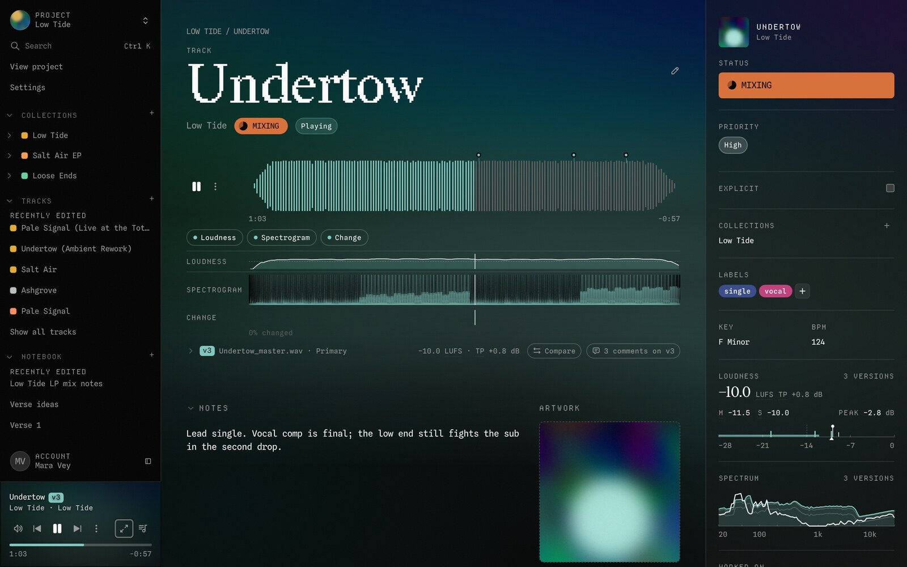
</p>

# Projammr

**A home for unfinished music.** Projammr keeps a producer's catalogue organised as
**projects → collections → tracks → sessions**, reads the Ableton sets behind those tracks straight off the disk,
and puts every bounce, version, measurement, lyric and piece of feedback for a song in one place.

It is a self-hosted web app, dit, a desktop app that watches your DAW project folders, and a public listening page
for the people outside the project. All three share one design language: a dim listening room lit by the music's
own artwork.

## Who it is for

**A producer, and the small circle around one record.**

- **The producer** owns the projects, runs dit against their Ableton folders, and uses Projammr to see
  where every song stands, what changed in last night's session, and what needs listening or finishing next.
- **Collaborators** (co-writers, band members, a mix engineer) are project members. They listen to versions, leave
  timecoded feedback on the audio, and co-manage statuses, tracks, notes and collections.
- **Outsiders** (a label, a manager, friends) are not members. They hear a song through a share link, on a public
  page with no app shell, and can comment there without an account.

Ableton Live is the only DAW dit reads today. Everything else in the app is DAW-agnostic.

## Why not a normal project tracker

A generic tracker (Notion, Trello, a spreadsheet) can be bent into a song list. It cannot do these four things,
and Projammr is built around them:

1. **It reads the DAW.** dit parses your `.als` files, so saves, set structure (tracks, groups, devices,
   clip counts), plugins and save-to-save diffs come from the work itself, not from anything you typed in.
2. **Listening comes first.** Audio versions, waveforms, timecoded comments, loudness measurement, a listening queue
   and a persistent player are the centre of how songs get reviewed, not an attachment on a card.
3. **The whole song lifecycle.** One place from a lyric idea in the notebook, through sessions and bounces, to a
   sequenced, mastered collection.
4. **The music owns the identity.** Each project, collection and track is lit by its own cover art. The page accent,
   the player and the share page all take their colour from the record, so the tool feels like part of it.

## What it does

**Catalogue**

- Projects hold collections (albums, EPs, loose ends), tracks and sessions. Tracks carry artists, priority, an
  explicit flag, ISRC/ISWC, notes and any number of collections; collections carry a release date and UPC.
- Statuses are user-defined with a colour and a completion percentage, so a collection knows it is "3 of 9 done".
  Labels, track relations (remix, remaster, rework, edit, live version, cover, instrumental, acoustic) and
  attachments (stems, PDFs, zips) sit alongside.
- Every list is one table treatment: filters, grouping, sorting, saved views, a board view, bulk edits, and a
  command palette (<kbd>Ctrl</kbd>/<kbd>⌘</kbd> <kbd>K</kbd>) with trigram search across everything in a project.
- Cover art is uploaded once, resized on the server, and its accent colour extracted there, so the artwork is the
  only source of hue on every page.

**Listening and review**

- Several audio versions per track with one primary. Each version is decoded once on upload and measured:
  integrated loudness (LUFS), loudness range, true peak, BPM, key, sections, a loudness curve, a spectrogram,
  stereo correlation, clipping, leading and trailing silence, and a long-term average spectrum.
- Versions are compared against each other: a change map per second between consecutive versions, and duplicate
  detection when the same bounce is uploaded twice.
- Comments pin to a position on the waveform. Threads live on projects, collections, tracks, sessions and audio
  versions.
- A persistent player with a queue and a now-playing sheet, a live loudness meter driven by an AudioWorklet, and
  collection-level loudness, spectrum, tempo and key summaries.
- **The Lab**: speed and pitch, an EQ drawn over the live spectrum, a compressor with a gain-reduction meter,
  reverb, auditions (mono, crossfeed, dim, normalise, band solo, polarity), match EQ against another version, and
  a bounce that uploads the result as a new attachment. All of the maths is one Rust crate compiled to
  WebAssembly, shared by the server's analysis job, the page and the worklet.

**Session intelligence**

- A session is an Ableton set: tempo, key, time signature, track and scene counts, Live version, sample paths and
  the full track/device structure, all read from the file.
- Every save dit sees (and every file in Live's `Backup/` folder) becomes a revision. The history page
  diffs any two saves: tracks added or removed, devices added, clip and sample counts.
- A work heatmap per track, per project and across every project; a plugin inventory that names each device, whether
  it is Live's own or third party, and which sessions use it.
- "Open in DAW" links (`projammr://`) open the set on the machine that has the file.

**Writing**

- A notebook whose notes are encrypted at rest under a per-note key wrapped by a master key. A note can be linked to
  a track as its lyrics.
- Lyrics mode shows syllable counts and rhyme-scheme marks per line, with rhyme and synonym lookups from a bundled
  pronouncing dictionary and WordNet.

**Collaboration**

- Members with roles (owner, admin, editor, viewer), invites by email, ownership transfer, and an activity feed of
  who changed what.
- Share links for a track or a collection, either a **snapshot** frozen at creation or **connected** to the live
  sequence, with optional public or private comments, optional downloads and an expiry.
- Installable as a PWA. The service worker caches the app's build files, its icons and the most recent cover art
  (up to 200 images), and shows an offline page when the network is gone. Audio always streams from the server, so
  playback needs a connection.

**Automation and integration**

- dit runs in the menu bar tray, watches your project folders, records each save as a revision and pushes it to
  your instance.
- Long work (analysis, transcodes, image variants, backfills) runs as background jobs with real progress, streamed
  to the page over server-sent events, with retry and cancel.
- An MCP endpoint lets an AI client (Claude Code, for example) read and write a project over OAuth with `read` and
  `write` scopes: projects, tracks, sessions, notes, lyrics, audio versions and jobs.
- The whole API is described by OpenAPI and browsable at `/api/docs`.

## Screenshots

The data shown is a demo project seeded through the public API. The audio is synthesised, which is why the
waveforms are so tidy.

<table>
  <tr>
    <td width="50%">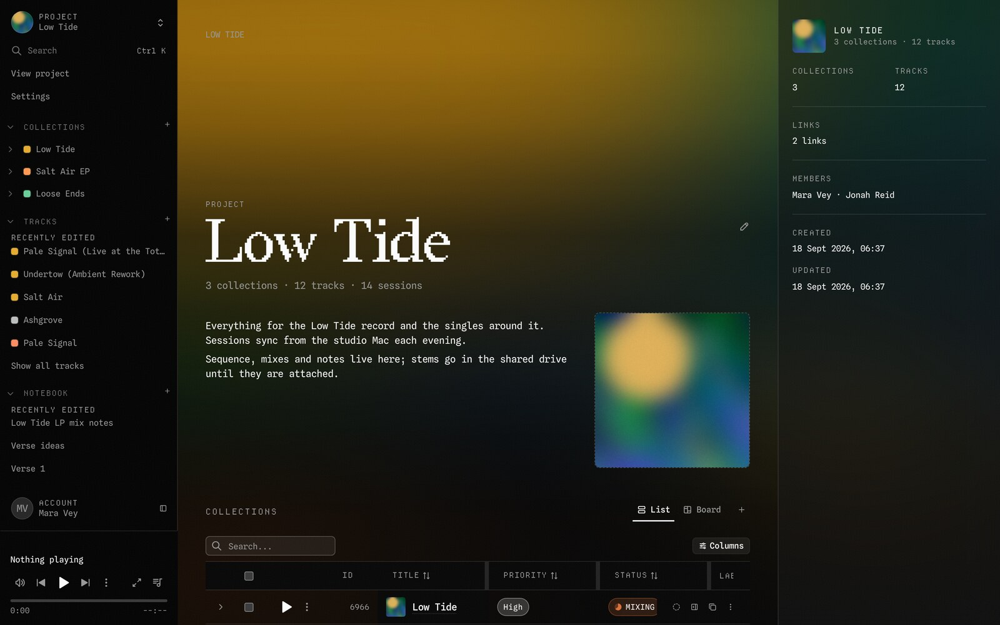</td>
    <td width="50%">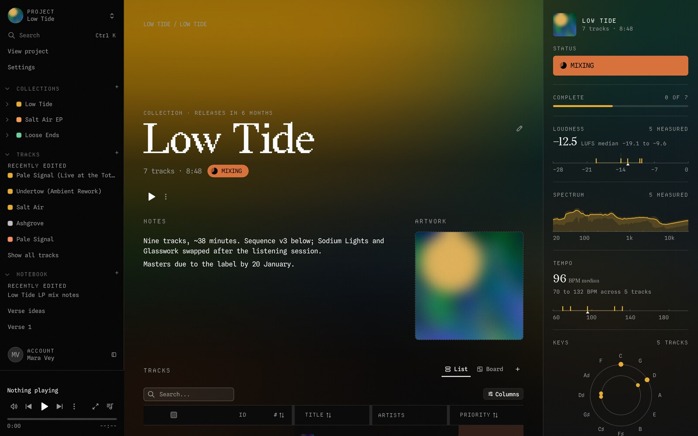</td>
  </tr>
  <tr>
    <td><em>A project. The masthead is the loud element; everything else sits back.</em></td>
    <td><em>A collection with its loudness, spectrum, tempo and key readouts.</em></td>
  </tr>
  <tr>
    <td>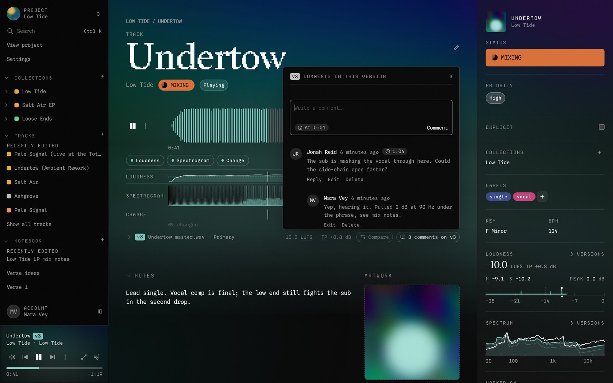</td>
    <td>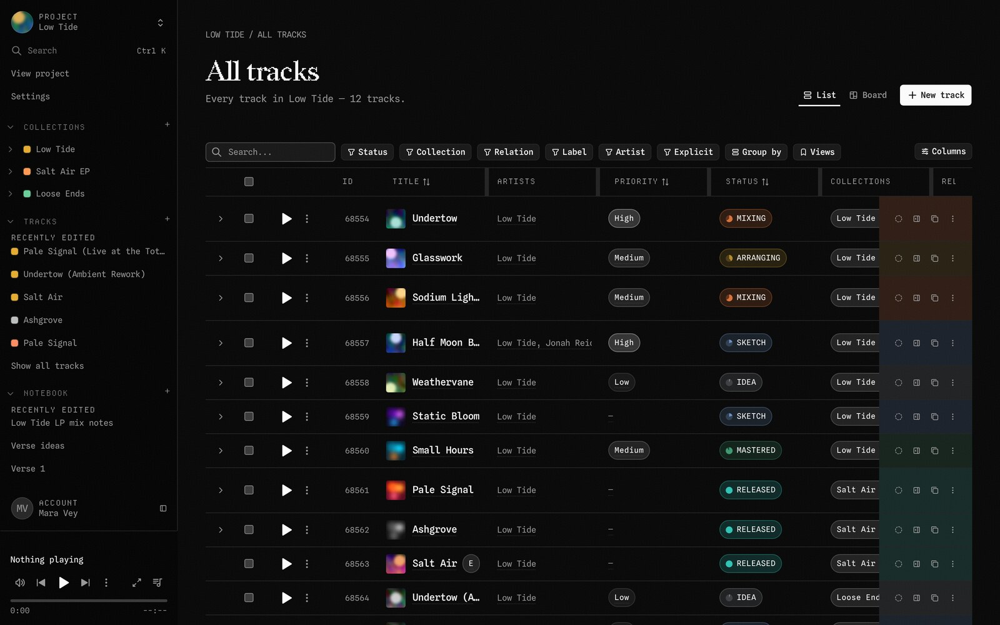</td>
  </tr>
  <tr>
    <td><em>Timecoded comments on a version, from a collaborator and the producer.</em></td>
    <td><em>Every track in the project, with filters, grouping and saved views.</em></td>
  </tr>
  <tr>
    <td>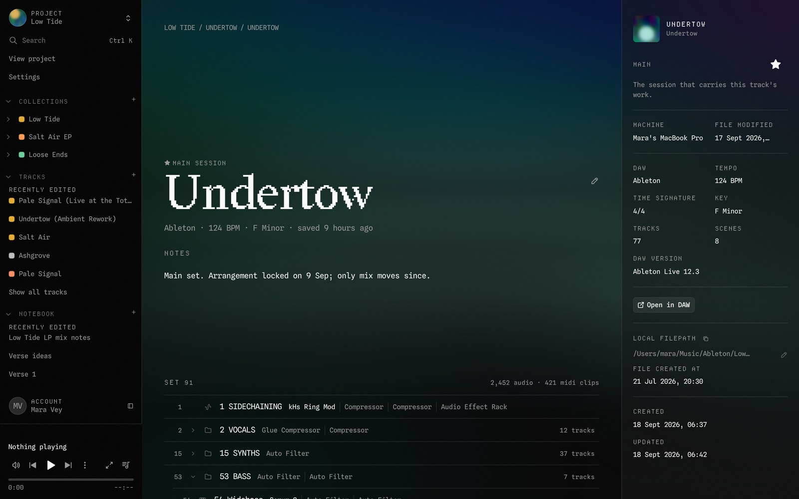</td>
    <td>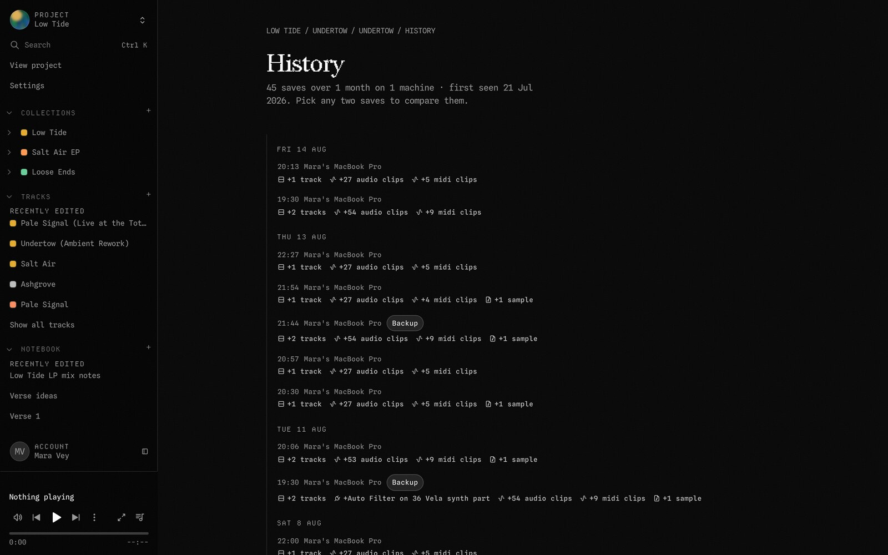</td>
  </tr>
  <tr>
    <td><em>A session read from the <code>.als</code>: 91 tracks, 2,452 audio clips, and the device chain per track.</em></td>
    <td><em>Its save history, diffed save to save, including backups Live wrote.</em></td>
  </tr>
  <tr>
    <td>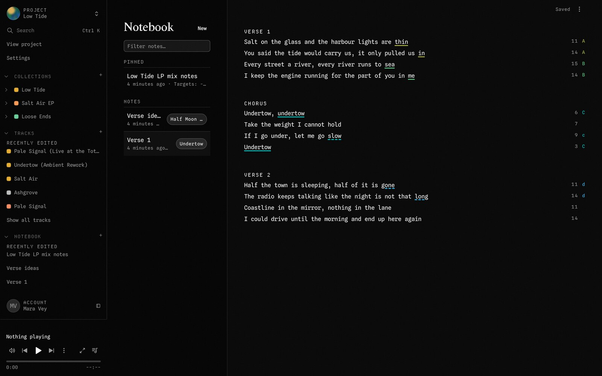</td>
    <td>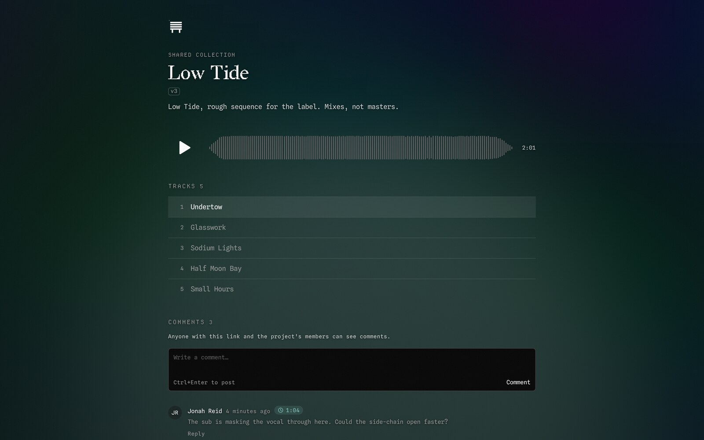</td>
  </tr>
  <tr>
    <td><em>The notebook in lyrics mode, linked to a track.</em></td>
    <td><em>What an outsider sees through a share link.</em></td>
  </tr>
  <tr>
    <td>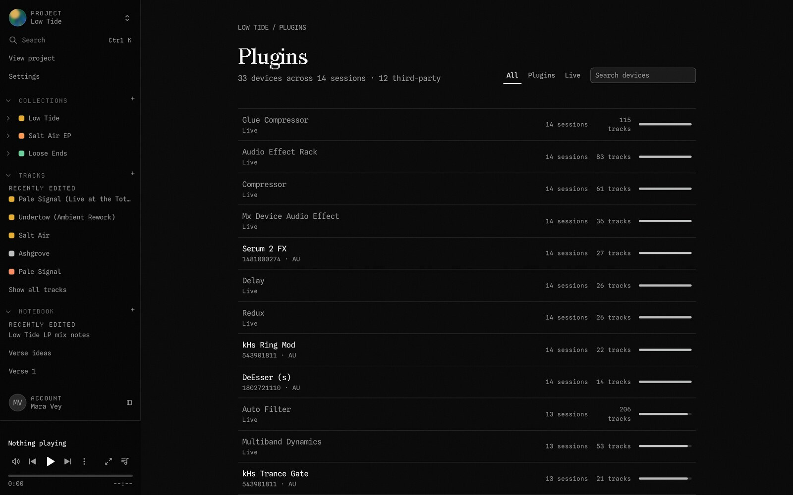</td>
    <td>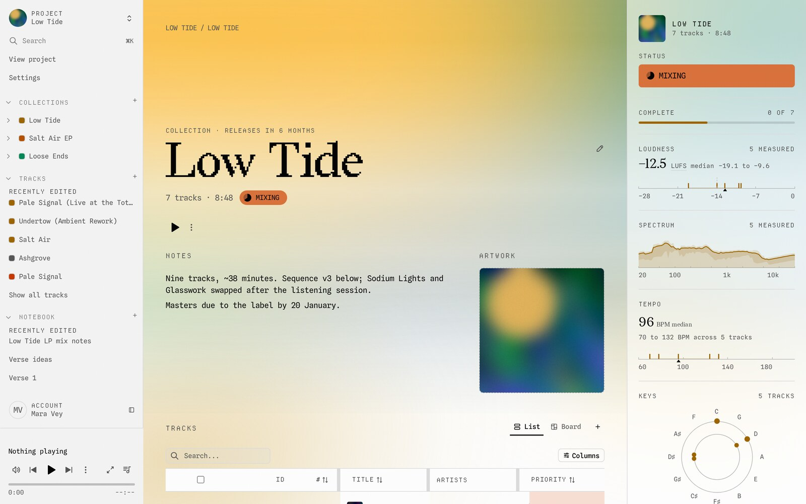</td>
  </tr>
  <tr>
    <td><em>The plugin inventory across a project's sessions.</em></td>
    <td><em>The light theme. Artwork is still the only source of colour.</em></td>
  </tr>
</table>

<p align="center">
  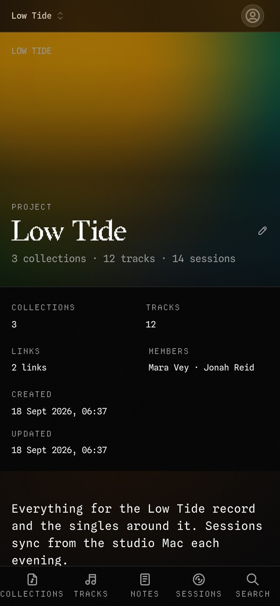
  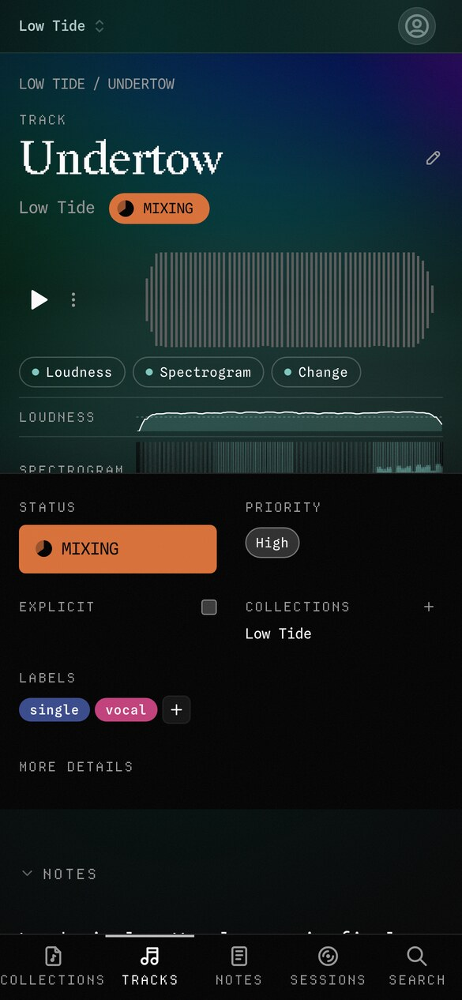
  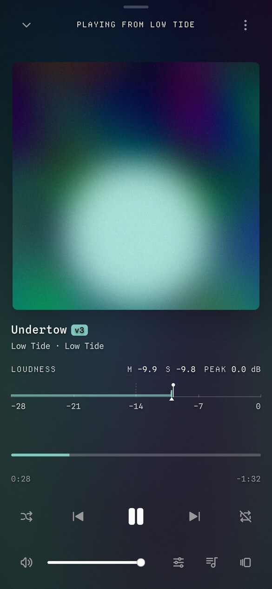
</p>
<p align="center"><em>On a phone: the project, a track, and the now-playing sheet with the live loudness meter.</em></p>

## How the pieces fit

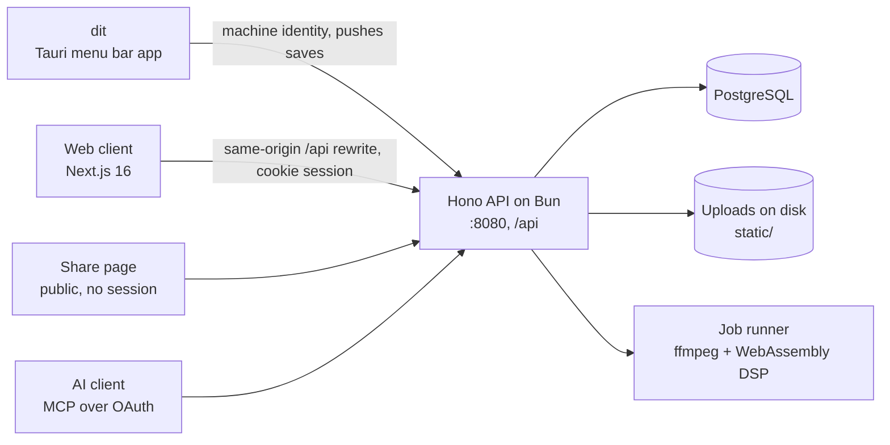

The **server** is the single source of truth. Every route is defined with `hono-openapi`, the spec is served at
`/api/openapi`, and the client types in `packages/api` are generated from it. Better Auth runs inside the same app:
email and password with cookie sessions for the browser, a bearer token for dit, and an OAuth provider with
JWTs for MCP clients.

The **client** renders that data with React Server Components and server actions, both typed through
`@workspace/api`. Browser requests go through a Next.js rewrite so the session cookie stays first-party.

**dit** watches Ableton project folders, parses each set, records every save as a revision and pushes it
through the same API under a machine identity.

## Status

Projammr is self-hosted software, released as two Docker images (the API and the web app) and dit, the desktop app. You
run your own instance; there is no hosted service, and no public sign-up. The first account on an instance becomes
its admin, and others join by invite or share link. Releases are tagged on the
[Releases page](https://github.com/backshelf/projammr/releases), and security fixes go to the latest minor release
([SECURITY.md](SECURITY.md)). The project website and docs live in [`apps/web`](apps/web/).

## How AI is used

Projammr is a heavily AI-assisted project. This section says exactly how, so that nobody finds out after they have
installed it or opened a pull request.

**What the AI does.** AI coding agents write most of what is in this repository. That covers more than the
application code: the tests, the documentation (this README included), the implementation plans and issue
descriptions the work is cut from, and the first pass of code review are AI-generated too.

**What the human does.** One person sets the product direction, decides the design and architecture questions the
agents raise, approves each plan before production code is written, and reads and merges every pull request.

**What that review does not cover.** Small fixes are committed straight to `master` without a pull request, and a
large pull request does not always get a line-by-line read. Assume any given line was written by an AI, and do not
assume a human has read it. The automated gates described under [Development](#development) run on every pull
request and every push to `master`.

People have their reasons for not using or not trusting AI-generated code, and many of those reasons are sound. If
that is you, Projammr may not be the right fit, and that is completely fair. This section is here so you can make
that call before you have put any time into it.

## Getting started

Projammr runs on one machine with Docker Compose, from the published images
`ghcr.io/backshelf/projammr-api` and `ghcr.io/backshelf/projammr-web`. From a clone of the repository:

```bash
cp .env.example .env           # set BETTER_AUTH_SECRET, NOTES_MASTER_KEY and PUBLIC_HOST
docker compose up -d
```

`docker compose up -d` pulls the latest release. To run a specific one, set `PROJAMMR_VERSION` (for example
`PROJAMMR_VERSION=1.2.0`) in `.env`.

dit, which reads your Ableton project folders and pushes them to your instance, is a macOS menu bar app (Apple
silicon, macOS 14 or later). [Download it](https://github.com/backshelf/projammr/releases/latest/download/dit-macos-arm64.dmg)
from the latest release.

To build the images from source instead:

```bash
docker compose -f docker-compose.yml -f docker-compose.build.yml up -d --build
```

Either way, the stack is Postgres, the API, the web app and a Caddy proxy. The proxy is the only service published on the
host, on ports 80 and 443: it serves the app over HTTPS at `https://<PUBLIC_HOST>` and routes `/api` and `/media`
to the API, so dit signs in at that same address. Each device trusts the proxy's local certificate
authority once, from `http://<PUBLIC_HOST>/ca.crt`. With a Tailscale account, `docker-compose.tailscale.yml`
serves the stack from a Tailscale node instead, under a certificate every device already trusts, and through
Funnel on the internet too.

The [self-hosting docs](https://projammr.example/docs/self-hosting/) cover the rest: the full quickstart, trusting
the certificate on each platform, every `.env` variable, backups, upgrades, operations and running without Docker.
The same pages are in the repository under
[`apps/web/src/content/docs/docs/self-hosting/`](apps/web/src/content/docs/docs/self-hosting/). To run a
development checkout (`bun run dev`), see [Development](#development) and the contributing docs'
[development setup](apps/web/src/content/docs/docs/contributing/development-setup.mdx).

## Repository layout

A Bun workspace driven by Turborepo.

| Path                                                                 | Package                        | What it is                                                                                                                                                              |
| -------------------------------------------------------------------- | ------------------------------ | ----------------------------------------------------------------------------------------------------------------------------------------------------------------------- |
| [`apps/client`](apps/client/README.md)                               | `client`                       | Next.js 16 web app: App Router, React 19, server components first                                                                                                       |
| [`apps/server`](apps/server/README.md)                               | `server`                       | Hono REST API on Bun, PostgreSQL through Drizzle, Better Auth, the job runner, the MCP endpoint                                                                         |
| [`apps/dit-app`](apps/dit-app/CLAUDE.md)                             | `dit-app`                      | Tauri 2 menu bar app: reads DAW sets, records saves as revisions and pushes them to your instance                                                                       |
| `apps/web`                                                           | `web`                          | Static Astro + Starlight site: the project website and the docs (guide, dit, collaboration, admin, API, self-hosting, contributing), under `src/content/docs/docs/` |
| [`packages/ui`](packages/ui/README.md)                               | `@workspace/ui`                | shadcn/ui-based component library and the design-token stylesheet every surface shares                                                                                  |
| [`packages/api`](packages/api/README.md)                             | `@workspace/api`               | Generated API types, the `openapi-fetch` client, the Better Auth client, shared enums                                                                                   |
| [`packages/dsp`](packages/dsp/README.md)                             | `@workspace/dsp`               | Audio analysis and the Lab's playback chain, in Rust compiled to WebAssembly, with its TypeScript loader                                                                |
| [`packages/test`](packages/test/README.md)                           | `@workspace/test`              | The few helpers `bun:test` lacks, shared by every suite                                                                                                                 |
| [`packages/eslint-config`](packages/eslint-config/README.md)         | `@workspace/eslint-config`     | Shared ESLint 9 flat configs                                                                                                                                            |
| [`packages/typescript-config`](packages/typescript-config/README.md) | `@workspace/typescript-config` | Shared tsconfig presets                                                                                                                                                 |
| `docs/screenshots`                                                   |                                | The images in this file                                                                                                                                                 |
| `samples`                                                            |                                | A real Ableton project used as a dit fixture (gitignored)                                                                                                           |

## Development

### Root scripts

Every root script is a thin Turborepo wrapper that fans out to the workspaces.

| Script              | What it does                                                                                      |
| ------------------- | ------------------------------------------------------------------------------------------------- |
| `bun run dev`       | Start the client, the API, the dit app and the docs site (`apps/web`, :4321) in dev mode          |
| `bun run build`     | Build every package (the DSP crate first, then the API types, then the apps)                      |
| `bun run typecheck` | Regenerate the API types, then `bun check` in every workspace. **The real gate.**                 |
| `bun run lint`      | ESLint across the workspaces. Every rule is a warning locally; CI runs it with `--max-warnings 0` |
| `bun run test`      | Every test suite except the server's (`bun test`, colocated `*.test.ts`)                          |
| `bun run typegen`   | Regenerate `packages/api/src/v1.d.ts` and `packages/api/src/enums.ts` from the OpenAPI document   |
| `bun run format`    | Prettier, with the Tailwind class-sort plugin                                                     |
| `bun run audit`     | `bun audit` at the `high` level                                                                   |

The server suite needs a live database and runs on its own: `cd apps/server && bun run test`.

The same gates run in GitHub Actions on every pull request and push to `master`
(`.github/workflows/ci.yml`): lint, typecheck and build, the workspace tests, the server tests against a Postgres
service, both Docker images, and the audit.

### Regenerating API types

`packages/api/src/v1.d.ts` (gitignored) and `packages/api/src/enums.ts` (committed) are generated from the
server's OpenAPI document. Generation is offline: it builds the Hono app in-process, so no server or database is
needed. Regenerate after any route or enum change and commit `enums.ts` with it:

```bash
bun run typegen
git diff --exit-code packages/api/src/enums.ts   # non-empty means commit the regenerated file
```

### Adding UI components

shadcn components are added from the client and land in `packages/ui/src/components`:

```bash
bunx shadcn@latest add button -c apps/client
```

Import them anywhere as `@workspace/ui/components/button`. Read `DESIGN.md` first: the design language is
deliberately quieter than stock shadcn.

### Conventions

- Prettier: 2-space indent, semicolons, double quotes, print width 80.
- TypeScript is strict with `noUncheckedIndexedAccess`. Every workspace is on TypeScript 7.
- Commits follow Conventional Commits, `type(scope): summary`. [`CONTRIBUTING.md`](CONTRIBUTING.md) covers branches,
  pull requests and what a good one contains.
- The architecture and the engineering principles are in [`AGENTS.md`](AGENTS.md). The
  product definition is in [`PRODUCT.md`](PRODUCT.md) and the visual system in [`DESIGN.md`](DESIGN.md). Coding
  agents also read the per-app `CLAUDE.md` files and the references in `docs/agents/`.
- Third-party data bundled with the server (the pronouncing dictionary and WordNet behind the lyrics tools) is
  credited in [`THIRD_PARTY_NOTICES.md`](THIRD_PARTY_NOTICES.md).
