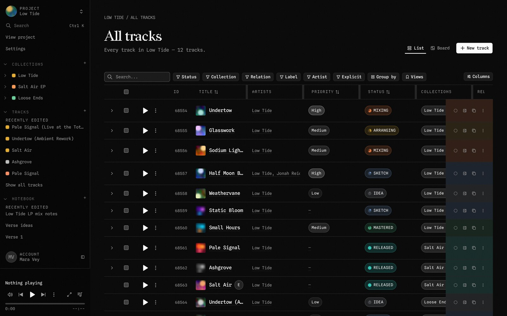

# Projammr web client (`apps/client`)

The web app: Next.js 16 (App Router, React 19, server components first), running on Bun. It talks to the Hono API
through the typed client in `@workspace/api`, renders with components from `@workspace/ui`, and is the surface a
producer and their collaborators live in: tables, entity pages, the player, the notebook, the lyrics editor, and the
public share page.

<p align="center">
  
</p>

Read `node_modules/next/dist/docs/` before writing Next.js code: this version has breaking changes from earlier
releases (`proxy.ts` instead of `middleware.ts`, `params` is a Promise, Turbopack by default). Read `DESIGN.md` at
the repo root before touching UI.

## Setup

```bash
bun install                           # from the monorepo root
# apps/client/.env
#   BETTER_AUTH_SECRET=<the same value the API uses>
bun run dev                           # http://localhost:3000
```

The API is expected at `http://localhost:8080` unless `INTERNAL_API_URL` says otherwise. Every script runs on
Bun (`bun --bun next`). Another port: `bun --bun next dev -p 3001`.

### Environment

| Variable | Required | Purpose |
| --- | --- | --- |
| `BETTER_AUTH_SECRET` | yes | The client verifies Better Auth's session cookie in its own process on every render instead of asking the API, so it needs the same signing secret the API uses. The app refuses to read a session without it. |
| `INTERNAL_API_URL` | no | The API address for server-side calls (server components, server actions, and `proxy.ts`'s forward of the browser's `/api` requests), such as `http://api:8080` under Docker compose. Defaults to `http://localhost:8080`. It is read when the server starts, never at build time, so one build serves any hostname: the browser only calls its own origin, and the public origin and scheme come from each request. |

## Scripts

| Script | What it does |
| --- | --- |
| `bun run dev` | Builds the DSP AudioWorklet processor into `public/`, then `next dev` on :3000 |
| `bun run build` | The same worklet build, then a production build (`output: "standalone"`) |
| `bun run start` | Serve the production build |
| `bun run lint` | ESLint (flat config, `@workspace/eslint-config/next-js`) |
| `bun run typecheck` | `bun check` |
| `bun run test` | `bun test --parallel` over the colocated `*.test.ts` and `*.test.tsx` files |

The client compiles against `packages/api/src/v1.d.ts`, which is generated and gitignored. Run `bun run typegen`
from the repo root after any server route change (or `bun run typecheck`, which runs it first); no running server
is needed.

## What is in here

- **Entity pages** for projects, collections, tracks and sessions, each with an artwork masthead, a rail of facts
  and readouts, notes, comments, attachments and an activity feed.
- **Tables** for tracks, collections and sessions: one shared treatment with filters, grouping, sorting, column
  choice, saved views, a board view and bulk edits.
- **The player**: a persistent sidebar player with a queue, a now-playing sheet, keyboard control, a live loudness
  meter, and the Lab (speed and pitch, EQ over the live spectrum, compressor, reverb, auditions, match EQ, bounce).
- **Audio versions** on a track: waveform with comment pins, loudness curve, spectrogram and change lanes, version
  comparison, primary selection, transcoding and download.
- **Session structure and history**: the set's track and device tree, the save timeline with diffs, the work
  heatmap, and the project-wide plugin inventory.
- **Notebook and lyrics editor**: encrypted notes, lyrics mode with syllable counts, rhyme marks and dictionary
  lookups, notes linked to tracks.
- **Sharing**: share-link management on tracks and collections, and the public share page.
- **Settings**: one hub for your own settings, each project's (statuses, labels, images, assets, members and the
  danger zone), the instance's (accounts, registration, storage, version) and the device's.
- **Jobs**: background work (analysis, transcodes, image variants) streamed into the page with progress, retry and
  cancel.
- **PWA**: a manifest, icons drawn from the logo, a service worker that caches the static bundle and cover images,
  and an offline page.

## Routing

File routes exist only at the top level, most of them inside the `(app)` group that renders the signed-in shell:

```
src/app/layout.tsx                          Root: fonts, metadata, theme, motion and haptics providers
src/app/(app)/layout.tsx                    The signed-in shell: sidebar, player, dock, palette, hotkeys, jobs
src/app/(app)/page.tsx                      "/": sign in, or redirect to the current project, or the project list
src/app/(app)/sign-in, consent             Sign-in page and the OAuth consent page the MCP flow lands on
src/app/(app)/profile/page.tsx
src/app/(app)/settings/…                    The settings hub: personal, project, instance and device sections
src/app/(app)/admin/[[...tab]]/page.tsx     Redirects the old admin URLs into the hub's instance section
src/app/(app)/invite/[token]/page.tsx       Public invite acceptance
src/app/(app)/notes/…                       The notebook: list, new note, one note
src/app/(app)/project/new/page.tsx
src/app/(app)/project/[projectId]/layout.tsx          Loads the project, provides the member role
src/app/(app)/project/[projectId]/[...route]/page.tsx Everything below a project
src/app/share/[token]/…                     The public share page and its media proxies, outside the shell
src/app/media/[...path]/route.ts            Proxy to the API's /static/* with cookies and Range forwarded
src/app/offline/page.tsx                    Served by the service worker when the network is gone
```

Everything under `/project/:projectId` is parsed by hand. `src/lib/route-parser.ts` turns URL segments into a
discriminated union of route kinds (`project`, `track`, `collection`, `session`, their `new` and `all` variants,
`session-history`, `plugins`, `samples`), and `src/modules/{project,collection,track,session}/` supplies the page for
each kind. To add a page, extend the parser and the module registry. Never add file routes below `[projectId]`, and
never build a `/project/...` string by hand; use `hrefFromParsedRoute` or the `redirect` helper in `src/lib/utils.ts`.
A project's settings live in the settings hub at `/settings/project/:projectId`; its URLs come from
`src/lib/settings/href.ts`.

`src/proxy.ts` (Next 16's name for middleware) redirects `/project/*`, `/notes/*`, `/profile`, `/settings` and
`/admin` to `/` when there is no session cookie.

## Data flow

- **Server actions** in `src/actions/`, one `"use server"` file per resource. Each calls the `openapi-fetch` client
  from `@workspace/api`, forwards the request cookie, and returns either data or `{ error }`.
- **Browser calls** use the same client. `proxy.ts` forwards `/api/*` to the API, so every browser request is
  same-origin and the HttpOnly session cookie rides along with no CORS involved.
- **Uploads** post multipart straight to the API through that rewrite, bypassing server actions and their body
  limit.
- **Media URLs** always go through `/media/*` (see the helpers in `src/lib/utils.ts`), never straight to `/static`,
  so the API can gate every file on the viewer's session.
- Entity pages fetch the critical data first, then hand un-awaited promises to `Suspense`-wrapped subcomponents.
  Request-scoped caches live in `src/lib/server-data.ts`.
- Live updates (jobs, the player) come over server-sent events and in-page stores; the server stays the source of
  truth and the client refetches rather than keeping its own copy.

## Auth

Better Auth is served by the Hono API. The `/api` rewrite makes its session cookie first-party to this origin;
`src/lib/auth-server.ts` reads the signed cookie cache with `BETTER_AUTH_SECRET` for server-side rendering, and the
browser uses the client from `@workspace/api/lib/auth-client`. Member roles come from `hooks/use-project-role.tsx`
and gate UI only; the server enforces them.

## UI

- Components come from `@workspace/ui` (shadcn, radix-mira style, Tabler icons). Add new ones from this
  directory: `bunx shadcn@latest add <name> -c apps/client`.
- Tailwind v4 through `@workspace/ui/globals.css`; the design tokens live there, and `DESIGN.md` explains them.
- Tables are TanStack Table **v9** through the shared components in `src/components/tables/`; v8 examples do
  not apply. Fonts load through `next/font/local` from `public/fonts/`.
- Forms use react-hook-form + zod v4. Rich text is BlockNote. Toasts are Sonner. Animation is the `motion` package behind
  the shared `MotionProvider`, and everything respects `prefers-reduced-motion`.
- Dark mode is the `.dark` class, from the viewer's `appearance.theme` setting; the <kbd>d</kbd> key toggles it. <kbd>Ctrl</kbd>/<kbd>⌘</kbd>
  <kbd>K</kbd> opens the command palette.

## Tests

`bun test --parallel` over colocated `*.test.ts` and `*.test.tsx`. Pure helpers in `src/lib/` carry most of the
coverage. Shared stubs (`stubGlobal`, `stubEnv`, fake-timer and polling helpers) come from `@workspace/test`.

## Gotchas

- `params` and `searchParams` are Promises, and dynamic segments arrive as strings.
- `images.unoptimized` is on: the image optimizer has no session cookie for `/media`.
- `public/sw.js` and `public/dsp-processor.js` are sent with `no-store`; a cached worker or a stale worklet would
  run the previous ABI against the current WebAssembly module.
- Check for an already running dev server before starting another one.
